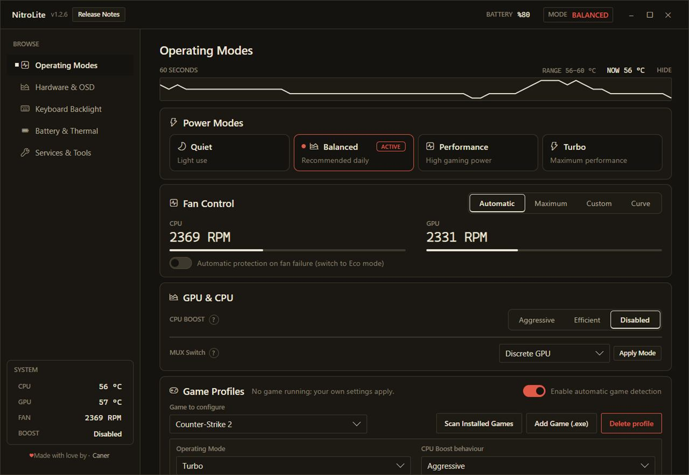

# NitroLite

<p align="center">
  <picture>
    <source media="(prefers-color-scheme: dark)" srcset="docs/brand/logo-2026/kit/lockups/nitrolite-horizontal-reversed.svg">
    
  </picture>
</p>

[](https://dotnet.microsoft.com/)
[](https://www.microsoft.com/windows)
[](https://github.com/canerztk8/NitroLite/wiki/Linux)
[](https://github.com/canerztk8/NitroLite/wiki/Tests)
[](LICENSE)

<p align="center">
  <a href="https://github.com/canerztk8/NitroLite/releases/latest"><b>Download for Windows</b></a> ·
  <a href="https://youtu.be/0FmFyp4AykY">45-second demo</a> ·
  <a href="#compatibility">Model compatibility</a> ·
  <a href="#install">Install</a> ·
  <a href="https://github.com/canerztk8/NitroLite/wiki">Wiki</a>
</p>

<p align="center">
  <a href="https://ko-fi.com/cztrk"></a>
</p>

<p align="center">
  <sub>One student, no company: <b>over $100 out of pocket</b> and <b>hundreds of hours</b> so far. Free and MIT-licensed either way.</sub>
</p>

<p align="center">
  
</p>

**NitroLite replaces NitroSense.** It is a small, open-source control centre for Acer Nitro and Predator laptops: power
modes, fan speed and fan curves, keyboard RGB, the battery charge limit, an in-game overlay and per-game profiles, in
one window that stays out of the way in the tray.

It was written on an **Acer Nitro 16 AN16-41** (Ryzen 7840HS + RTX 4070) but it is not tied to that machine. At
startup it reads the model, the CPU vendor and what the firmware says the hardware can do, then shows only the
controls your laptop actually has. See [Compatibility](#compatibility).

**You do not need NitroSense installed.** If Acer's service is there, NitroLite uses it and never asks for
administrator rights. If it is not, NitroLite talks to the firmware directly instead, at the cost of one UAC prompt
per session. Details in [Without Acer's software](https://github.com/canerztk8/NitroLite/wiki/Without-Acer-Software).

**It is light.** About a 19.7 MB download holding a 24 MB exe, roughly 70 MB of RAM while it sits in the tray, and
about 0.2 % of one core at idle. No Electron, no background service, no kernel driver, no telemetry.

---

## Screenshots

<p align="center">
  <a href="docs/screenshots/en-dark-NavModes.jpg"></a>
  <a href="docs/screenshots/en-dark-NavMonitoring.jpg"></a>
</p>
<p align="center">
  <a href="docs/screenshots/en-dark-NavLighting.jpg"></a>
  <a href="docs/screenshots/en-dark-NavBattery.jpg"></a>
</p>
<p align="center">
  <a href="docs/screenshots/en-dark-NavTools.jpg"></a>
</p>

All five pages, in English and in the dark theme, are in [`docs/screenshots`](docs/screenshots). They are captured by
`scripts/screenshot.ps1` against a throwaway data folder, so they show a fresh install rather than the author's
settings. The same script captures any of the eight languages and any of the fourteen themes; see
[Capturing screenshots](https://github.com/canerztk8/NitroLite/wiki/Tests#capturing-screenshots) on the wiki.

The tour above is also on [YouTube](https://youtu.be/0FmFyp4AykY): 45 seconds, 1080p60, captions burned in. A copy of
the same cut is in [`docs/video`](docs/video) for anyone who would rather not use YouTube.

---

## What you get

### Power modes and fans
- **Five modes** — Quiet, Balanced, Performance, Turbo and Eco — as single-click cards. The keyboard's own mode key
  cycles them the way NitroSense does.
- **Fan control:** automatic, maximum, a fixed speed per fan (30–100 %), or a **fan curve you draw yourself** — six
  points from 40 °C to 90 °C, with hysteresis so it does not hunt up and down on a temperature that sits on a step.
  Three templates (Balanced, Quiet, Gaming) fill all six points in one click. The curve is stored and written to the
  fans as you move an anchor, so there is no Apply button; the templates take the same path.
- **A hand-set speed is held to a thermal floor.** A speed below what the current temperature allows is raised rather
  than accepted, and the fans go back to the firmware before the app exits.
- **CPU boost** — Aggressive, Efficient or Disabled, written into the active Windows power plan.
- **GPU mode (MUX)** — Automatic, Optimus or NVIDIA only, limited to the modes your firmware reports. A change takes
  effect after a restart, and NitroLite can start that restart for you.

A higher fan speed moves more air; it does not guarantee a lower temperature. On a chassis whose cooler is already
saturated the reading barely moves. The curve is a way to trade noise against temperature, not a promise of a number.

### Keyboard lighting
- The zone count and the effect list come from the keyboard itself, so a single-zone model gets the controls it can
  actually use instead of a four-zone picker that does nothing.
- **Two transports, chosen by trying.** On most models the colour goes through the firmware's WMI method. On the 2025
  boards that method answers "success" and the LEDs do not move, so NitroLite tries the keyboard's own HID controller
  once — the documented ENE `KB5130` feature report — remembers which path worked for that `model|BIOS`, and uses it
  from then on. A controller with no published frame is named in the hardware report and never written to, and the
  keyboard's normal input collection is never opened.
- Static, breathing, wave, neon, slide, zoom, meteor and sparkle, plus your own saved profiles.
- **Every change applies as you make it** — no Apply button. The backlight-off state survives a restart, and a colour
  set by hand marks the profile as Custom so the picker never claims a preset is selected when it is not.
- **Temp-Reactive Lighting**, if you want the keyboard to follow the processor: three ready-made ramps — Aurora (ice
  blue → mint → amber → red), Inferno (amber → orange → red) and Nebula (turquoise → blue → violet → magenta) — are
  drawn on their chips, so the choice is a look rather than a name. **Custom** opens an editor: one temperature and
  one colour per stop, between 20 and 110 °C, up to eight stops, and one button that adds a stop in the widest gap.
  The ends hold their colours instead of going dark at idle or inventing a colour hotter than the ramp. It is an
  overlay, not a saved colour — switching it off puts your own colour back, and picking a colour by hand switches it
  off. The reading is rounded to 3 °C and written at most once every three seconds, so it costs the keyboard a handful
  of writes an hour, not one per telemetry tick.

### Battery
- **80 % charge limit**, set through Acer Care Center or the firmware and read back to confirm. On a laptop with
  neither, the option is disabled and says why.
- **Live telemetry:** charge/discharge power, time remaining, full-charge capacity and wear level. Values Windows does
  not report are labelled "(estimated)".
- **Wear trend:** a line under the battery card with the change over the recorded period and a per-year rate once
  there are at least seven days of history. Only measured values are stored.
- **Automatic Eco on battery**, and **School mode** — one switch that writes battery-only values into the power plan
  and sets Eco, 60 Hz, low brightness and the backlight off. Every value it replaces is saved first, so turning it off
  puts the machine back exactly as it was. No fixed number of extra hours is promised: the card reports what it
  changed, not an estimate it cannot measure.

### On-screen display
Three lines over your game: CPU (temperature, estimated power, clock, usage), GPU (temperature, power, clock, VRAM),
RAM and fan. No DLL is injected into the game — it is only a transparent always-on-top window, and it can sit in any
corner.

### Per-game profiles
NitroLite scans your Steam and common library folders and checks for a running game every two seconds. Each game can
carry its own power mode, CPU boost, fan setting (or its own fan curve) and mouse profile; leaving the game restores
the desktop settings.

### Health
Battery, SSD and thermal cards in one page. Disk temperatures without SMART access, and thermal paste or fan bearing
estimates, are marked "(estimated)".

### Services & Tools
Every Acer and Windows maintenance task in one place, with one click and no external `.bat` or `.ps1`:
- **Repair the keyboard RGB service** and **repair the Acer / NitroSense services** — point the registry at the current
  binaries and restart them.
- **Repair the MUX switch entry** — verifies `discrete_gpu_support = 1` and clears stale session tasks.
- **Windows & system optimisation** — HAGS, NVMe TRIM, telemetry tasks and background service cleanup. Every change is
  backed up, and **Restore** puts it all back.
- **Start-up and integration** — start with Windows, start in the tray, and an optional elevated logon task that
  removes the UAC prompt entirely.
- **The Nitro key** — the laptop's own key opens NitroLite, and no longer opens NitroSense behind it.

### First run
Three steps on first launch: what the probe found on this machine, which of it is supported, and the optional elevated
auto-start. Skippable, and it does not come back once finished. **Settings → Show the walkthrough again** brings it
back.

A control the firmware does not support is hidden, or disabled with the reason next to it, instead of failing when
pressed. A failure says what to do next.

---

## Install

### Scoop (no SmartScreen prompt)

```powershell
scoop install https://raw.githubusercontent.com/canerztk8/NitroLite/main/packaging/scoop/nitrolite.json
```

Scoop unpacks the release into `~\scoop\apps\nitrolite\current`, puts a `NitroLite` shim on `PATH` and adds a Start
menu shortcut. The file never passes through a browser, so it carries no Mark of the Web and SmartScreen has no
reputation check to run: the "Windows protected your PC" prompt does not appear. `scoop update nitrolite` picks up a
new version once the manifest is bumped, which `scripts/publish-release.ps1` does on every release.

### Manual download

1. Download `NitroLite-v1.2.8-win-x64.zip` from the
   **[Releases](https://github.com/canerztk8/NitroLite/releases/latest)** page.
2. Extract it to a **permanent folder**, for example `C:\Users\<you>\Programs\NitroLite`. Do not leave it in
   Downloads: "run at Windows startup" remembers where the exe lives.
3. Open `NitroLite\NitroLite.exe`. There is no installer and **no .NET install needed**; the runtime is inside the
   exe.
4. If Windows says "**Windows protected your PC**", click **More info → Run anyway**, or read
   [Why SmartScreen warns](#why-smartscreen-warns) first.

Closing the window keeps NitroLite running in the system tray. To quit completely, right-click the tray icon and
choose **Exit**.

### Verify the download

One line, in PowerShell, in the folder you downloaded to:

```powershell
Get-FileHash .\NitroLite-v1.2.8-win-x64.zip -Algorithm SHA256 | Format-List
```

`Hash` must equal the digest printed on the release page. The same value is attached to the release as
`NitroLite-v1.2.8-win-x64.zip.sha256`, in `sha256sum` format, so `sha256sum -c` works too. The updater inside the app
performs this comparison itself and refuses to swap the executable on a mismatch.

### Why SmartScreen warns

The prompt is about **provenance, not detection**: NitroLite is unsigned, so Windows has no publisher reputation to
check. It does not mean Microsoft found something in the file. Run it with **More info → Run anyway**, verify the
SHA-256 digest against the release page, and read the full explanation — including what you can check without
trusting the author — on the
**[Why SmartScreen warns](https://github.com/canerztk8/NitroLite/wiki/Why-SmartScreen-warns)** wiki page.
The digest only proves the download matches the release; it says nothing about who published it. See
**[Trust and code signing](https://github.com/canerztk8/NitroLite/wiki/Trust-and-Code-Signing)** for what that
does and does not cover.

### Requirements
- **Windows 11** (Windows 10 x64 also works), 64-bit.
- **Acer services are optional.** With `AcerAgentService` installed (it ships with NitroSense) NitroLite uses it and
  never asks for elevation. Without it, the direct-WMI backend takes over and asks once per session. Acer Care
  Center is only needed for the 80 % charge limit on machines whose firmware has no `WMID_GUID5`.
- **Tested hardware:** Acer Nitro 16 AN16-41. On other Nitro / Predator models some features may stay locked,
  depending on what the firmware exposes. See [Compatibility](#compatibility).

### When does it ask for administrator rights?
NitroLite runs as a normal user. Windows asks for confirmation (UAC) only for:
- **The direct-WMI backend**, once per session, and only when Acer's service is not answering. Declining it leaves
  the app running in read-only mode. Turning on **Start automatically with administrator rights** removes the
  prompt entirely.
- **Standby memory purge:** WinMemoryCleaner needs administrator rights to release the standby list, so Windows
  asks each time you press the button. The tool itself ships with NitroLite; nothing to install.
- **Disabling / restoring Acer background services.**
- **Turning the elevated auto-start task on or off**, once in each direction.

### Uninstall
1. On the Services & Tools page, turn off **Start with Windows**. If you disabled services, press **Restore**.
2. Quit NitroLite from the tray and delete its folder. To remove the settings too, delete `%LOCALAPPDATA%\NitroLite`.
   The bundled WinMemoryCleaner goes with the folder; nothing else is left behind.

If you used **Windows & system optimisation**, run `NitroLite.exe --uninstall-cleanup --yes` before deleting the
folder. NitroLite has no installer, so nothing else undoes those Windows-level changes or removes the autostart
entry.

---

## Compatibility

NitroLite targets the whole Acer Nitro line (Nitro 5, 16 and 17; Nitro V 15 and 16; Intel and AMD), not one SKU.
Nothing about the hardware is hardcoded: the app asks, and hides what the answer does not cover.

| What | Where the answer comes from | When the answer is missing |
|---|---|---|
| Model, family, BIOS, CPU vendor | SMBIOS (`Win32_ComputerSystem`, `Win32_BaseBoard`, `Win32_BIOS`) | the device block says SMBIOS did not answer |
| Operating modes | `SUPPORT_OPERATING_MODE_CAPABILITY`, or the WMI method list | every mode stays visible, because a failed query is not evidence a mode is absent |
| Keyboard zones and effects | `GET_CONNECTED_DEVICE` | the four-zone layout stays, for the same reason |
| GPU mode (MUX) | `SUPPORT_GPU_MODE_CAPABILITY`, or `dgpu_mode_capability` in the registry | mode switching is disabled with a note, never guessed |
| 80 % charge limit | Acer Care Center (`AcerCCAgent`), or `WMID_GUID5` | the checkbox is disabled and says why |
| Fan curve | the Acer service's own fixed-speed command, or `SetGamingFanSpeed` | the curve turns itself off and says so |
| The Acer service itself | `AASSvc` on `127.0.0.1:46933` | the direct-WMI backend takes over; if that is unavailable too, a standing note names the missing service and everything Windows and NVIDIA can measure keeps working |

**No kernel driver, no EC register writes.** Fan and lighting control go through the Acer service that NitroSense
already uses, or through the firmware's own WMI class, and CPU boost through the Windows power plan. Nothing here
loads `WinRing0` or any other driver, which is the usual reason an anti-cheat refuses to start next to a hardware
tool. That is a statement about what NitroLite loads, not a guarantee: anti-cheat vendors keep their own allow-lists,
and a game that blocks unsigned overlays will still block the OSD.

### If your model is not covered

The short version: **Settings → Export hardware report** writes a redacted report into the data folder — model
code, BIOS, Acer service states, the keyboard report, the capability verdicts and the HID controllers the machine
exposes. Attach it to a GitHub issue, or press **Settings → Report compatibility on GitHub** to do both steps at
once. When a setting simply does nothing, the **NitroSense snapshot diff** under **Settings → Diagnostics**
narrows it down to the exact register. All of it is documented in detail — including what the report does and
does not contain — on the
**[Compatibility](https://github.com/canerztk8/NitroLite/wiki/Compatibility)** wiki page.

The same report is available without the window: `NitroLite.exe --hardware-report` (add `--json` for JSON, or
`--out <folder>` to write both files).

---

## Languages, themes and typefaces

**Eight languages** — English, Türkçe, Deutsch, Español, Русский, Português, हिन्दी and Bahasa Indonesia. Pick one in
**Settings → Language**; NitroLite restarts itself in about a second to apply it. On first launch it follows the
Windows display language when it is one of the eight, and falls back to English otherwise. If a word reads wrong in
your language, please
[open a translation issue](https://github.com/canerztk8/NitroLite/issues/new?title=Translation%20correction&labels=translation)
with the language and the correct text.

**Fourteen themes** — **Settings → Theme** offers **System default** plus fourteen palettes from Warm Cream
(the light default) to Midnight OLED, Nord Frost and Neon Sunset, each previewed as a card with five swatches and
held to the same contrast floors, so a palette cannot ship unreadable. The OSD is dark in every case.

**Eight typefaces** — **Settings → Typeface** picks the face the whole window is drawn in; all eight travel
inside the executable, so the window looks the same on a machine that has installed nothing. The default is
Quicksand. Nothing renders as tofu in any of the eight languages.

Both tables — every palette and every face — are on the
**[Languages, themes and typefaces](https://github.com/canerztk8/NitroLite/wiki/Languages-Themes-and-Typefaces)**
wiki page.

---

## Updating

NitroLite checks GitHub for a newer release 30 seconds after launch and then every 6 hours; the check can be turned
off in Settings. When a new version exists, an **Update v1.x.x** button appears next to the version label at the top
left. One click downloads the package, compares its SHA-256 against the digest GitHub publishes, swaps the
executable and restarts.

- Nothing is downloaded during a game session.
- A development build never updates itself; the button opens the release page instead.
- If the folder is not writable, NitroLite says so and opens the release page.
- NitroLite is unsigned, so trust rests on HTTPS to GitHub plus the digest check. If the GitHub account were
  compromised, that check would not save you — two-factor authentication on the account is the real protection.

You can still update by hand: close NitroLite from the tray, extract the new zip over the same folder, and your
settings stay where they are in `%LOCALAPPDATA%\NitroLite`.

---

## Support this project

NitroLite is written by one student, in his own time, and it is not free to build. Between the hardware it is tested
on, the Windows and Linux machines it has to keep working on, the code-signing and store fees that were tried and
abandoned, and the tools used along the way, this project has cost **more than $100 out of pocket** — on top of
**hundreds of hours** of evenings, weekends and holidays. There is no company behind it, no ads, no paid tier and no
telemetry: the whole thing is MIT-licensed and stays that way.

If NitroLite saved you from NitroSense, or from buying a tool that does less, you can put something back:

<p align="center">
  <a href="https://ko-fi.com/cztrk"></a>
</p>

A GitHub Sponsors page is in the works; the account is not enrolled yet, so the Ko-fi link above is the one that
works today. Stars, bug reports with a hardware report attached, and translation corrections are worth just as much
as money — they are what makes the next model work.

---

## Documentation (wiki)

Everything else lives in the [**NitroLite wiki**](https://github.com/canerztk8/NitroLite/wiki):

- **[Why SmartScreen warns](https://github.com/canerztk8/NitroLite/wiki/Why-SmartScreen-warns)**
- **[Compatibility](https://github.com/canerztk8/NitroLite/wiki/Compatibility)** — capability probing, the direct-WMI fallback, remote model profiles, hardware reports
- **[Backup and restore](https://github.com/canerztk8/NitroLite/wiki/Backup-and-Restore)**
- **[Reporting a bug](https://github.com/canerztk8/NitroLite/wiki/Reporting-a-Bug)**
- **[Command line](https://github.com/canerztk8/NitroLite/wiki/Command-Line)** — scriptable maintenance and one-shot hardware commands
- **[Linux (experimental)](https://github.com/canerztk8/NitroLite/wiki/Linux)** — install, udev rule, Nitro key
- **[Without Acer's software](https://github.com/canerztk8/NitroLite/wiki/Without-Acer-Software)** — the two backends, the elevation prompt, write verification
- **[Architecture](https://github.com/canerztk8/NitroLite/wiki/Architecture)** — the four projects, file by file
- **[Build from source](https://github.com/canerztk8/NitroLite/wiki/Build-from-Source)** and **[Tests](https://github.com/canerztk8/NitroLite/wiki/Tests)**
- **[Languages, themes and typefaces](https://github.com/canerztk8/NitroLite/wiki/Languages-Themes-and-Typefaces)**
- **[Trust and code signing](https://github.com/canerztk8/NitroLite/wiki/Trust-and-Code-Signing)**
- **[How many people use it](https://github.com/canerztk8/NitroLite/wiki/Usage-Statistics)**
- **[License](https://github.com/canerztk8/NitroLite/wiki/License)**

---

## License

This project is released under the [MIT License](LICENSE). The eight embedded typefaces are licensed under the SIL
Open Font License 1.1, and the packaged [WinMemoryCleaner](https://github.com/IgorMundstein/WinMemoryCleaner) is
GPL-3.0 and shipped as a separate, unmodified executable. Details on the
**[License](https://github.com/canerztk8/NitroLite/wiki/License)** wiki page.

---

<p align="center">
  <a href="https://ko-fi.com/cztrk"></a>
</p>
