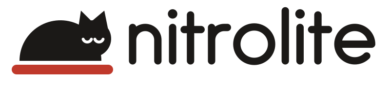
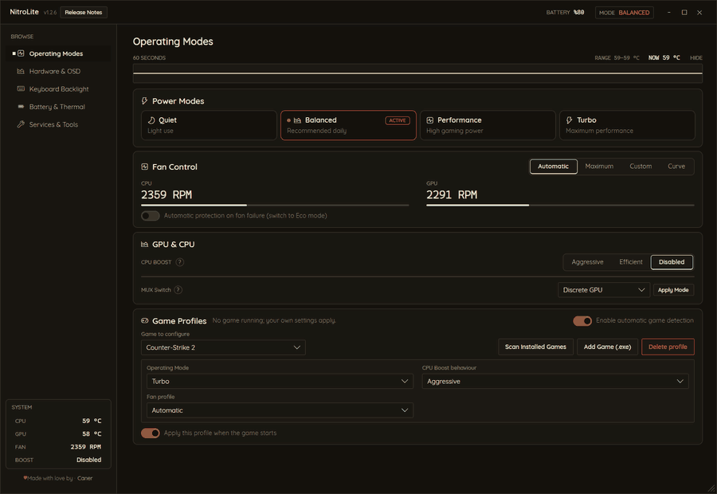
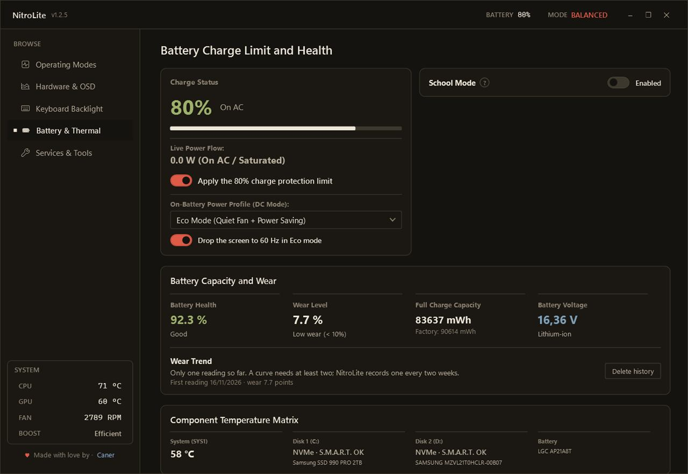

# NitroLite

<p align="center">
  <picture>
    <source media="(prefers-color-scheme: dark)" srcset="docs/brand/logo-2026/kit/lockups/nitrolite-horizontal-reversed.svg">
    
  </picture>
</p>

<p align="center">
  <b>A small, free replacement for NitroSense on Acer Nitro and Predator laptops.</b>
</p>

<p align="center">
  <a href="https://github.com/canerztk8/NitroLite/releases/latest"></a>
  <a href="https://github.com/canerztk8/NitroLite/wiki/Installing-on-Windows"></a>
  <a href="https://github.com/canerztk8/NitroLite/wiki/Linux"></a>
  <a href="LICENSE"></a>
</p>

<p align="center">
  <a href="https://github.com/canerztk8/NitroLite/releases/latest"><b>Download</b></a> ·
  <a href="https://youtu.be/0FmFyp4AykY">45-second demo</a> ·
  <a href="https://github.com/canerztk8/NitroLite/wiki/Features">All features</a> ·
  <a href="https://github.com/canerztk8/NitroLite/wiki">Wiki</a>
</p>

<p align="center">
  
</p>

## What it does

- **Power modes**: Quiet, Balanced, Performance, Turbo and Eco in one click.
- **Fans**: automatic, maximum, a fixed speed, or a fan curve you draw yourself.
- **Keyboard lighting**: colours, zones, effects, and a colour that follows your temperature.
- **Battery**: 80 % charge limit (on Linux, where the kernel or a module offers it), health, wear trend and a school
  mode for long days.
- **In-game overlay**: CPU, GPU, RAM and fan over your game, without touching the game.
- **Per-game profiles**: each game gets its own mode and fan setting, restored when you quit.

It shows only the controls your laptop actually has. No account, no ads, no telemetry, and you do not need NitroSense
installed. About a 21 MB download and 70 MB of RAM in the tray.

→ **[Every feature in detail](https://github.com/canerztk8/NitroLite/wiki/Features)**

## Screenshots

<p align="center">
  <a href="docs/screenshots/en-dark-NavModes.jpg"></a>
  <a href="docs/screenshots/en-dark-NavMonitoring.jpg"></a>
</p>
<p align="center">
  <a href="docs/screenshots/en-dark-NavLighting.jpg"></a>
  <a href="docs/screenshots/en-dark-NavBattery.jpg"></a>
</p>

## Install

### Windows

1. Download **`NitroLite-v1.3.1-win-x64.zip`** from the **[latest release](https://github.com/canerztk8/NitroLite/releases/latest)**.
2. Extract it to a folder you will keep (not Downloads).
3. Open **`NitroLite.exe`**. Nothing else to install.

If Windows says "Windows protected your PC", click **More info → Run anyway**. NitroLite is not signed, so Windows does
not know the publisher yet; **[here is why, and how to check the file](https://github.com/canerztk8/NitroLite/wiki/Why-SmartScreen-warns)**.

Prefer no warning at all? Install with [Scoop](https://scoop.sh):

```powershell
scoop install https://raw.githubusercontent.com/canerztk8/NitroLite/main/packaging/scoop/nitrolite.json
```

→ **[Full Windows guide](https://github.com/canerztk8/NitroLite/wiki/Installing-on-Windows)**: checking the download,
administrator prompts, uninstalling.

### Linux

Download the package for your distribution from the **[latest release](https://github.com/canerztk8/NitroLite/releases/latest)**
and open it: **`.deb`** for Ubuntu, Debian, Mint and Pop!_OS, **`.rpm`** for Fedora and openSUSE. If double-clicking
does not open an installer, run `sudo apt install ./NitroLite-*.deb` (or `sudo dnf install ./NitroLite-*.rpm`).

That is all: open NitroLite from the menu. The package installs a small helper service, so there is no setup step and
no logging out. Temperatures, the graphics card and power modes work on most laptops; fan speed and keyboard colour
depend on your model and kernel.

→ **[Linux guide](https://github.com/canerztk8/NitroLite/wiki/Linux)**: what works, and how to unlock more.

## Will it work on my laptop?

NitroLite is written on an **Acer Nitro 16 AN16-41** and built for the whole Nitro line (Nitro 5, 16, 17, Nitro V) and
Predator models, Intel and AMD. Nothing is hard-coded: at start-up it asks the laptop what it can do and hides what is
not there.

If something is missing or does nothing, press **Settings → Report compatibility on GitHub**. It opens an issue with a
hardware report attached (no serial numbers or personal data), which is what makes the next model work.

→ **[Compatibility details](https://github.com/canerztk8/NitroLite/wiki/Compatibility)**

## Is it safe?

- **No kernel driver** and no low-level register writes: it uses the same Acer service NitroSense uses, or the
  firmware's own interface. That is also why it does not trip anti-cheat the way some hardware tools do.
- **Open source** under the MIT license. Every release is built by GitHub from the public code, with a SHA-256 checksum.
- **No telemetry.** NitroLite only contacts GitHub to check for updates, and you can turn that off.

→ **[Trust and code signing](https://github.com/canerztk8/NitroLite/wiki/Trust-and-Code-Signing)**

## Help

- **[Wiki](https://github.com/canerztk8/NitroLite/wiki)**: guides, troubleshooting and reference.
- **[Report a bug](https://github.com/canerztk8/NitroLite/wiki/Reporting-a-Bug)**: the app can collect everything needed
  for you.
- **[Languages](https://github.com/canerztk8/NitroLite/wiki/Languages-Themes-and-Typefaces)**: English, Türkçe, Deutsch,
  Español, Русский, Português, हिन्दी and Bahasa Indonesia, plus fourteen themes. A wrong word?
  [Tell us](https://github.com/canerztk8/NitroLite/issues/new?title=Translation%20correction&labels=translation).

## Support

NitroLite is made by one student in his free time: over $100 out of pocket and hundreds of hours so far. It is free and
stays free. If it saved you from NitroSense, you can put something back:

<p align="center">
  <a href="https://ko-fi.com/cztrk"></a>
</p>

A star, a bug report with a hardware report attached, or a translation fix helps just as much.

## License

[MIT](LICENSE). The bundled typefaces are under the SIL Open Font License 1.1, and the bundled
[WinMemoryCleaner](https://github.com/IgorMundstein/WinMemoryCleaner) is GPL-3.0, shipped unmodified as a separate
program. [Details](https://github.com/canerztk8/NitroLite/wiki/License).
