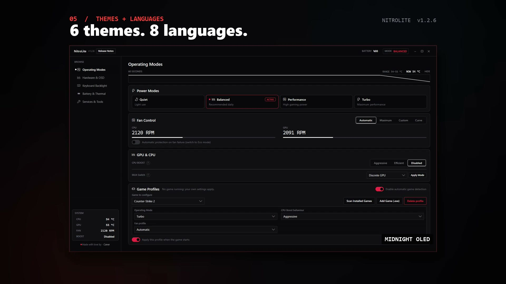
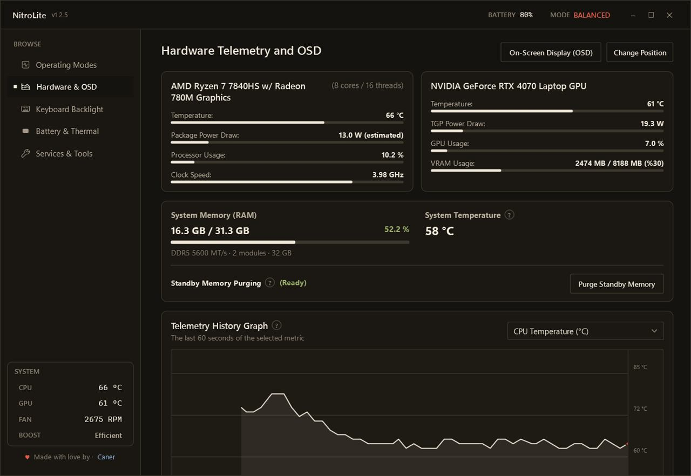
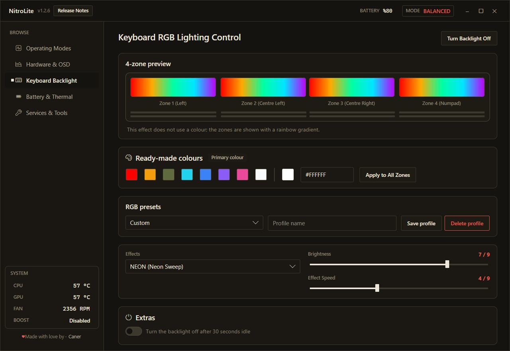
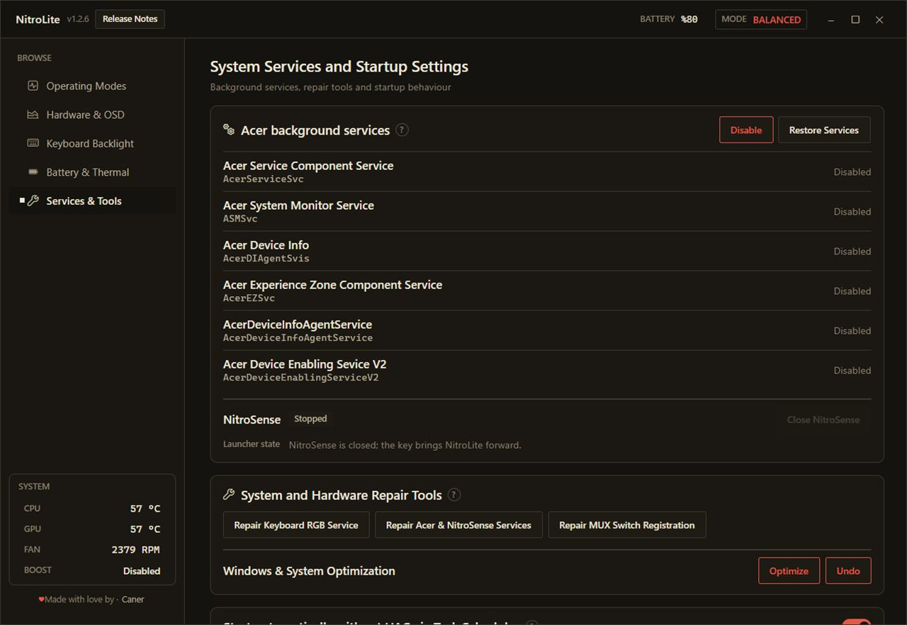

# NitroLite

[](https://dotnet.microsoft.com/)
[](https://www.microsoft.com/windows)
[](#linux-experimental)
[](#tests)
[](LICENSE)

<p align="center">
  <a href="https://github.com/canerztk8/NitroLite/releases/latest"><b>Download for Windows</b></a> ·
  <a href="https://youtu.be/0FmFyp4AykY">45-second demo</a> ·
  <a href="#compatibility">Model compatibility</a> ·
  <a href="#install-and-verify">Install</a>
</p>

<p align="center">
  
</p>

<p align="center">
  <a href="https://youtu.be/0FmFyp4AykY"></a>
  <br>
  <a href="https://youtu.be/0FmFyp4AykY"><b>Watch the 45-second tour</b></a> — 1080p60, captions on screen.
</p>

**NitroLite** is a lightweight, open-source replacement for NitroSense on Acer Nitro laptops. It was developed on an
**Acer Nitro 16 AN16-41** (Ryzen 7840HS + RTX 4070) and is not tied to that machine: at startup it reads the model,
the CPU vendor and what the firmware says the hardware can do, then shows only the controls this laptop actually
has. See [Compatibility](#compatibility).

**Acer's software is optional, not a requirement.** With NitroSense installed, NitroLite drives `AcerAgentService`
and never asks for elevation. Without it, the direct-WMI backend talks to the firmware's own `AcerGamingFunction`
class instead, at the cost of one UAC prompt per session. Which path a given laptop can take is a property of its
firmware, not a promise: the direct-WMI backend needs `AcerGamingFunction` to exist, the 80 % charge limit needs
either `WMID_GUID5` or Acer Care Center, and the MUX switch needs a capability report from the service or
`dgpu_mode_capability` in the registry. Where none of them answers, the control is disabled with the reason next to
it rather than failing when pressed. See [Without Acer's software](#without-acers-software).

The window is Avalonia, so the same front end runs on Windows and on Linux. See
[Linux (experimental)](#linux-experimental).

**Measured footprint** (AN16-41, 1.2.6, the published single-file build): about 70 MB working set in the tray, and
about 275 MB with the window open — most of that difference is the window's own surfaces, which Windows trims the
moment it is hidden. Idle CPU is about 0.2 % in Task Manager, which is 4 % of one core. Telemetry is read every
second while the window is on screen, every five seconds in the tray, and every half second while the OSD is up.

**New in 1.2.6:** the Avalonia rewrite, a Linux build, 31 model profiles, the Nitro key, the theme engine and a
2491-test suite. The full list is in [CHANGELOG.md](CHANGELOG.md).

---

## Screenshots

<p align="center">
  <a href="docs/screenshots/en-dark-NavMonitoring.jpg"></a>
  <a href="docs/screenshots/en-dark-NavLighting.jpg"></a>
</p>
<p align="center">
  <a href="docs/screenshots/en-dark-NavBattery.jpg"></a>
  <a href="docs/screenshots/en-dark-NavTools.jpg"></a>
</p>

All five pages, in English and in the dark theme, are in [`docs/screenshots`](docs/screenshots). They are captured
by `scripts/screenshot.ps1` against a throwaway data folder, so they show a fresh install rather than the author's
settings. The same script captures any of the eight languages and any of the six themes; see
[Capturing screenshots](#capturing-screenshots).

The tour above is on [YouTube](https://youtu.be/0FmFyp4AykY): 45 seconds, 1080p60, captions burned in. A 5.9 MB
copy of the same cut is in [`docs/video`](docs/video) for anyone who would rather not use YouTube, and the
full-quality master is attached to the [v1.2.6 release](https://github.com/canerztk8/NitroLite/releases/tag/v1.2.6).

---

## Features

### 1. Operating modes and fan
- **Five power modes:** Quiet, Balanced, Performance, Turbo and Eco, as single-click cards. Commands go through
  `AcerAgentService` (AASSvc, `127.0.0.1:46933`) using the same protocol as NitroSense, or — when that service is
  not installed — straight to the firmware's `AcerGamingFunction` WMI class. See
  [Without Acer's software](#without-acers-software).
- **Fan:** automatic curve, maximum speed, a fixed custom speed (CPU and GPU fan separately, 30–100 %), or a
  **software fan curve** you draw yourself.
- **What a fan setting can and cannot do.** A higher speed moves more air; it does not guarantee a lower
  temperature. On a chassis whose cooler is already saturated the reading barely moves, and how far it moves depends
  on the laptop, the thermal paste and the workload. The curve is a way to trade noise against temperature, not a
  promise of a number.
- **Software fan curve:** six points from 40 °C to 90 °C, each mapping a temperature to a fan speed. NitroLite reads
  the CPU temperature every few seconds and moves the fan to the matching speed. A 3 °C hysteresis and a minimum
  dwell time keep it from hunting up and down on a temperature that sits on a step. The curve is drawn as a trace
  that always matches the sliders, and the current operating point is marked on it. The default curve is quieter
  than the stock automatic one below 70 °C and louder above 80 °C.
- **Curve templates:** three shapes above the editor — Balanced, Quiet and Gaming — fill all six points in one
  click. A template is a shortcut, not a mode: moving a slider afterwards leaves it and the mark clears. Balanced
  is the default curve, so a fresh install opens with it already marked.
- **Manual sliders are held to the thermal floor.** A hand-set speed below what the current temperature allows is
  raised to the floor rather than accepted, and the fans are handed back to the firmware before the app exits.
- **Mode key:** the keyboard's mode/Turbo key cycles modes the way NitroSense does (on AC: Balanced → Performance →
  Turbo → Quiet; on battery: Balanced ↔ Quiet).
- If the mode cannot be read, the UI says "Unknown" instead of inventing a default.

### 2. CPU boost control
- Changes the processor boost setting in the active Windows power plan (PerfBoostMode): Aggressive, Efficient or
  Disabled. Disabled keeps the CPU at or below its base clock, which lowers temperature and fan noise.

### 3. GPU mode (MUX)
- Like NitroSense, the choice is limited to the modes the service reports (`SUPPORT_GPU_MODE_CAPABILITY`):
  Automatic, Optimus, NVIDIA only. A new mode takes effect after a restart, and NitroLite can start that restart for
  you. If the service reports no modes, the choice stays locked. NitroLite never edits the MUX registry keys itself.
- The row says which of the three modes is active and that a restart is needed, instead of showing a switch that
  looks applied when it is not.

### 4. Game detection and per-game profiles
- Scans installed games (Steam and the common library folders) and checks for a running game every 2 seconds.
- Each game can define a power mode, CPU boost, fan setting and mouse profile. Leaving the game restores the desktop
  settings. A change made while the game is running is applied immediately, not on the next launch.
- A game can also carry its **own fan curve** instead of a fixed speed, so a demanding title gets a louder curve than
  the desktop one. Turning it off falls back to the fan setting above.

### 5. ATK / VXE mouse integration (optional)
- Switches between Config 1–4 over HID, applies a per-game profile, and returns to the default profile when the game
  ends.
- A wireless mouse stops answering vendor commands while it sleeps, so a switch that arrives when it is idle is
  retried — every few hundred milliseconds at first, then every three seconds — and once more the moment you touch
  the mouse or keyboard. The sidebar row reads **Click** while it waits, and the profile applies as soon as you do.

### 6. Battery
- **80 % charge limit:** set through Acer Care Center (`AcerCCAgent`, `wss://localhost:4343`) the same way NitroSense
  does, or through the firmware's `WMID_GUID5` class on machines that expose it, then read back to confirm. On a
  laptop with neither, the option is disabled and says why.
- **Telemetry:** live charge/discharge power, estimated time remaining, full-charge capacity and wear level. Values
  Windows does not report are labelled "(estimated)".
- **Wear trend:** NitroLite keeps a history of the wear level it measured and draws it as a line under the battery
  card, with the change over the recorded period and a per-year rate once there are at least seven days of history.
  Only measured values are stored — a capacity Windows estimated, or a reading outside 0–100 %, is skipped rather
  than guessed. Wear moves over months, so a reading is written every **15 days**; a pack that loses a whole point
  sooner is recorded at once instead of waiting. At most 400 samples are kept, and **Clear history** deletes the
  file. The first trend line therefore appears two weeks after the first reading. The rate is an extrapolation of a
  short series, not a prediction: a battery that is recalibrated can move the line in either direction.
- **Automatic Eco on battery:** switching to battery applies a low-power mode and (optionally) 60 Hz on the internal
  display; plugging back in restores the previous settings. If the app crashes, the state is repaired on the next
  launch.
- **School mode:** one switch for the longest a charge can last. It writes battery-only values into the active power
  plan (CPU boost off, processor capped at 60 %, passive cooling, processor energy preference at maximum efficiency,
  Windows battery saver always on, screen off after 3 minutes, sleep after 10, disk off after 2, USB power saving on)
  and sets Eco mode, automatic fan, 60 Hz, 40 % brightness and the keyboard backlight off. Every value it replaces is
  written to `school_mode_backup.json` before the first change, so turning it off — or relaunching after a crash —
  puts the machine back exactly as it was. While it is on, the automatic AC/battery pass stands down instead of
  undoing it. **No fixed number of extra hours is promised.** The gain depends on what the machine was doing — a
  GPU-bound game barely moves, an idle browser session moves a lot — so the card reports the settings it changed and
  the steps that failed, not an estimate it cannot measure.

### 6b. Standby memory purge
- Converts the standby list Windows keeps cached into free memory without touching the memory of running programs.
  The card shows the current standby and free amounts, and the result reports available memory before and after —
  the figure that actually moves. The used-RAM bar does not, because cached pages were never counted as used.
- Runs [WinMemoryCleaner](https://github.com/IgorMundstein/WinMemoryCleaner), which ships inside the package under
  `tools\`, so there is nothing to install. Windows asks for confirmation (UAC) each time you press the button.
- Drop your own `WinMemoryCleaner.exe` into `%LOCALAPPDATA%\NitroLite\tools\` to use a different build; that copy
  wins over the bundled one.

### 7. OSD (on-screen display)
- Three lines: CPU (temperature, estimated power, clock, usage), GPU (temperature, power, clock, VRAM), RAM and fan.
- No DLL is injected into the game; it is only a transparent always-on-top window. It can sit in any of the four
  corners.

### 8. Keyboard RGB
- The zone count and the effect list come from the keyboard itself, so a single-zone or single-colour model gets
  the controls it can actually use instead of a four-zone picker that does nothing.
- Static, breathing, wave, neon, slide, zoom, meteor and sparkle effects, plus your own saved profiles.
- **Every change is applied as you make it.** There is no Apply button and no toast per write.
- **The backlight-off state is remembered.** Turning the lights off draws the four zones black instead of leaving the
  last colour on screen, and the state survives a restart.
- **A colour set by hand marks the profile as Custom**, so the picker never claims a preset is selected when the
  zones no longer match it.
- The setting is reapplied after sleep and at sign-in. The 30-second idle timeout is read from the device.
- If an **OpenRGB SDK server** is listening on `127.0.0.1:6742`, the page says so. NitroLite only reports it: it
  does not drive the keyboard through OpenRGB, because two programs writing the same HID device fight over it.

### 9. Health page
- Battery, SSD and thermal cards. Disk temperatures without SMART access, and thermal paste/fan bearing estimates,
  are marked "(estimated)".

### 10. Integrated system and repair tools
Every Acer and Windows maintenance task runs from the **Services & Tools** page with one click — no external
`.bat`, `.ps1` or separate `.exe`:
- **Repair the keyboard RGB service:** points the registry at the current `AcerLightingService.exe` in the driver
  store and repairs the services.
- **Repair Acer & NitroSense services:** updates the `AcerCentralService` and `AcerLightingService` paths, stops
  conflicting processes and restarts the services.
- **Repair the MUX switch entry:** verifies `discrete_gpu_support = 1`, clears stale persistent session tasks and
  starts the Quick Access service.
- **Windows & system optimisation:** HAGS (GPU hardware scheduling), NVMe TRIM, disabling telemetry tasks and
  background service cleanup. Every change is backed up to `optimize_backup.json`; **Restore** puts service start
  types, the HAGS value and the telemetry tasks back.
- **Command line:** `NitroLite.exe` also accepts `--fix-lighting`, `--fix-services`, `--restore-mux`, `--optimize-pc`,
  `--restore-optimize` and `--uninstall-cleanup`. Commands that change system settings ask for confirmation:
  `NitroLite.exe --optimize-pc --yes`. The same six commands are also reachable as `--cli <command>`, which is the
  form to prefer in new scripts because it does not need the second flag:

  ```bat
  NitroLite.exe --optimize-pc --yes
  NitroLite.exe --cli optimize
  ```

  `--yes`, `-y` and `--force` are all accepted. Without one, a legacy flag exits with code 3 and prints the line that
  would work; `--cli` runs straight away.
- **Before you delete the folder:** run `NitroLite.exe --uninstall-cleanup --yes`. NitroLite has no installer, so
  nothing else undoes the Windows-level changes **Windows & system optimisation** makes or removes the autostart
  entry. Skipping it leaves SysMain disabled and HAGS enabled after the app is gone.
- **One-shot hardware commands:** `--mode`, `--fan` and `--profile` change the machine and exit without opening the
  window, so a script, a launcher or a macro pad can drive them. They never write to `settings.json`; a running
  NitroLite picks the change up as an external change on its next poll.

  ```bat
  NitroLite.exe --mode turbo
  NitroLite.exe --mode balanced --fan auto
  NitroLite.exe --fan 45
  NitroLite.exe --profile 2
  ```

  `--mode` takes `turbo`, `performance`, `balanced`, `quiet` or `eco`. `--fan` takes `auto`, `max`, `custom` or a
  percentage from 30 to 100 (which means custom at that speed). `--profile` takes an ATK mouse config from 1 to 4.
  Exit codes: `0` applied, `1` the hardware refused, `2` timed out, `3` the command line was wrong.

### 11. The Nitro key
- The laptop's own Nitro key opens and focuses NitroLite, and the key no longer opens NitroSense behind it.
- Three paths are tried in order, because no single one works on every model: the ACPI event class, Raw Input, and
  the APGE WMI class (discovered on the AN16-41 specifically). NitroSense is swept for a few seconds after the key so
  a half-started copy is closed rather than left running.
- On Linux the key is read from `/dev/input`, which needs the `input` group. Without it the settings row hides itself
  and nothing else changes.

### 12. First-run walkthrough and diagnostics
- **Three steps on first launch:** what the probe found on this machine, which of it is supported, and the optional
  elevated auto-start. Skippable, and it does not come back once finished. **Settings → Show the walkthrough again**
  brings it back.
- **Capability-driven UI.** A control the firmware does not support is hidden, or disabled with the reason next to
  it, instead of failing when pressed.
- **Actionable toasts.** A failure says what to do next, and a long message stays on screen long enough to read.
- **Diagnostics bundle.** One button collects the log, the settings and the hardware report into a folder to attach
  to an issue.

---

## Without Acer's software

NitroLite used to be a front end for Acer's services: no `AcerAgentService`, no fan control. That is no longer
true. The hardware layer sits behind one interface with two backends, and the app chooses per call:

| Backend | Talks to | Needs |
|---|---|---|
| `AgentHardwareController` | `AcerAgentService` on `127.0.0.1:46933`, and Acer Care Center for the charge limit | NitroSense installed |
| `WmiHardwareController` | the firmware's `AcerGamingFunction` class, through an elevated helper process | one UAC prompt per session |
| `LinuxSysfsHardwareController` | `acer-wmi`, `hwmon`, `platform_profile` and Linuwu-Sense | the in-kernel driver |

`HybridHardwareController` picks one per call and reconciles the two on handover, so a machine that gains or loses
the Acer service mid-session does not end up with half its settings in one place and half in the other.

### The elevation prompt

`AcerGamingFunction` is a `dynamic` WMI class: reading it and writing it both need an elevated token. The window
itself stays `asInvoker` — it never asks for administrator rights at launch. Instead:

1. Everything Windows and NVIDIA can answer keeps working unelevated.
2. The first hardware **write** starts `NitroLite.exe --wmi-worker` with `Verb = "runas"`. That is one prompt per
   session. Declining it is remembered: the app keeps running in read-only mode and does not ask again.
3. The helper is a child process, not a service. A Job Object and a parent-process watchdog tie it to the window, so
   it dies with the app even if the app crashes.
4. The pipe it listens on is `CurrentUserOnly`, the first packet must carry a one-time 32-byte nonce, the caller is
   authenticated by process id, and the command set is a fixed list of typed operations — never a general "invoke
   this WMI method" call. The worker re-checks every bound itself (`30–100 %` fan speed, valid enum values) before
   touching the hardware.

If you would rather not see that prompt at all, **Settings → Start automatically with administrator rights (Task
Scheduler)** registers a logon task with `RunLevel HighestAvailable`. It is off by default and costs one prompt to
turn on and one to turn off; after that the helper inherits the elevated token and no prompt appears. Turning it on
removes the standard `HKCU\…\Run` entry, so Windows never starts NitroLite twice. The task definition is kept off the
disk.

### Writes are verified, not assumed

Every WMI write is followed by a read-back of the same value. If three attempts do not stick — a BIOS that accepts
the call and ignores it — that capability is switched off for the rest of the session and the app says so. Only
three consecutive sessions of failure disable it permanently, so one busy EC after a sleep/wake cycle cannot kill a
working feature. **Settings → Rescan hardware capabilities** clears the counters and probes again.

### Capability probing

Nothing about the hardware is hardcoded to one SKU. At startup NitroLite asks three questions in order:

1. **Schema and registry** — does `root\WMI` expose `AcerGamingFunction`, which methods does it declare, does
   `WMID_GUID5` exist, what does `dgpu_mode_capability` say. All read-only and unelevated.
2. **Model profile** — SMBIOS product and board are matched against an embedded, read-only `profiles.json` that
   carries sensor byte offsets, reference RPM ceilings and known-broken method signatures for 31 models across the
   Nitro 5/16/17, Nitro V 15/16 and Predator Helios/Triton families.
3. **Cache** — the result is stored under `SMBIOS product + BIOS version`, so a BIOS update invalidates it
   automatically.

A `profiles.user.json` in the data folder can add a model without a new release. It is validated strictly: unknown
fields, out-of-range RPM ceilings and malformed JSON are rejected and logged, and the default profile is used
instead. The thermal floors (`85 / 90 / 95 °C`), the `30–100 %` PWM bounds and the school-mode rules are compiled
into the app and cannot be relaxed by any profile file.

---

## Compatibility

NitroLite targets the whole Acer Nitro line (Nitro 5, 16 and 17; Nitro V 15 and 16; Intel and AMD), not one SKU.
Nothing about the hardware is hardcoded: the app asks, and hides what the answer does not cover.

| What | Where the answer comes from | When the answer is missing |
|---|---|---|
| Model, family, BIOS, CPU vendor | SMBIOS (`Win32_ComputerSystem`, `Win32_BaseBoard`, `Win32_BIOS`) | the device block says SMBIOS did not answer |
| Operating modes | `SUPPORT_OPERATING_MODE_CAPABILITY`, or the WMI method list | every mode stays visible, because a failed query is not evidence a mode is absent |
| Keyboard zones and effects | `GET_CONNECTED_DEVICE` | the four-zone layout stays, for the same reason |
| GPU mode (MUX) | `SUPPORT_GPU_MODE_CAPABILITY`, or `dgpu_mode_capability` in the registry | mode switching is disabled with a note, never guessed |
| 80 % charge limit | Acer Care Center (`AcerCCAgent`), or `WMID_GUID5` | the checkbox is disabled and says why |
| Fan curve | the Acer service's own fixed-speed command, or `SetGamingFanSpeed` | the curve turns itself off and says so |
| The Acer service itself | `AASSvc` on `127.0.0.1:46933` | the direct-WMI backend takes over; if that is unavailable too, a standing note names the missing service and everything Windows and NVIDIA can measure keeps working |

**No kernel driver, no EC register writes.** Fan and lighting control go through the Acer service that NitroSense
already uses, or through the firmware's own WMI class, and CPU boost through the Windows power plan. Nothing here
loads `WinRing0` or any other driver, which is the usual reason an anti-cheat refuses to start next to a hardware
tool. That is a statement about what NitroLite loads, not a guarantee: anti-cheat vendors keep their own allow-lists,
and a game that blocks unsigned overlays will still block the OSD.

### If your model is not covered

**Settings → Export hardware report** writes `hardware-report-<timestamp>.txt` and `.json` into the data folder
and opens it. The report lists the model code, BIOS, Acer service states, the keyboard report, the operating
modes, the GPU mode capability and whether the Acer WMI class answers. Attach it to a GitHub issue: it is the
difference between "the fan slider does nothing" and a fix. It contains no serial number, user name, file path or
log content — every line goes through the same redactor the log uses.

The same report is available without the window: `NitroLite.exe --hardware-report` (add `--json` for JSON, or
`--out <folder>` to write both files).

---

## Languages

The interface is written in English and translated into seven more languages. Pick one in **Settings → Language**;
NitroLite restarts itself in about a second to apply it.

| | | | |
|---|---|---|---|
| English | Türkçe | Deutsch | Español |
| Русский | Português | हिन्दी | Bahasa Indonesia |

- On first launch NitroLite follows the Windows display language when it is one of the eight, and falls back to
  English otherwise.
- Numbers, percentages and dates follow the chosen language.
- Technical terms (Turbo, Boost, OSD, MUX) stay untranslated.
- The translations were written by the author, not by native speakers. If a word reads wrong in your language,
  please [open a translation issue](https://github.com/canerztk8/NitroLite/issues/new?title=Translation%20correction&labels=translation)
  with the language and the correct text.

## Theme

**Settings → Theme** offers **System default** plus six palettes, each shown as a row of five swatches — page, card,
rule, ink and accent, in the order the palette defines them: the warm-cream "paper" theme, `Dark`, and four dark
variants — **Midnight OLED** (true black), **Slate Steel** (cold anthracite), **Amber Console** (warm amber) and
**Nord Frost** (glacier turquoise). All six share one key set and the same paper-and-ink hierarchy; only the
temperature of the ground and the hue of the accent move. System default follows the Windows app theme, resolved at
launch. The OSD is dark in every case. Like the language, the theme applies after a quick restart.

<p align="center">
  
</p>

## Updating

NitroLite checks GitHub for a newer release 30 seconds after launch and then every 6 hours; the check can be turned
off in Settings. When a new version exists, an **Update v1.x.x** button appears next to the version label at the top
left. One click downloads the package, compares its SHA-256 against the digest GitHub publishes, swaps the
executable and restarts.

- Nothing is downloaded during a game session.
- A development build never updates itself; the button opens the release page instead.
- If the folder is not writable, NitroLite says so and opens the release page.
- NitroLite is unsigned, so trust rests on HTTPS to GitHub plus the digest check. If the GitHub account were
  compromised, that check would not save you — two-factor authentication on the account is the real protection.

You can still update by hand: close NitroLite from the tray, extract the new zip over the same folder, and your
settings stay where they are in `%LOCALAPPDATA%\NitroLite`.

## Reporting a bug

**Settings → Report a bug** opens a GitHub issue with the version, Windows build, laptop model and language already
filled in. You see the text before anything is sent, and you can edit it. No user name, file path or log content is
added. Next to it, **Open log folder** takes you to the log if you want to paste an excerpt yourself,
**Create diagnostics bundle** collects the log, the settings and the hardware report into one folder, and
**Export hardware report** writes the capability report described under [Compatibility](#compatibility) — attach
it when the problem is about a feature that is missing or does nothing on your model.

## Backup and restore

**Settings → Backup** writes one JSON file holding your settings, game profiles and RGB profiles, so a new laptop or
a fresh Windows install does not mean setting everything up again. **Restore** reads that file back and restarts
NitroLite.

- The file is plain JSON with an `app` and `schema` marker; a file that is not a NitroLite backup is refused instead
  of half-applied.
- Two values are deliberately not carried across machines: the window position (it may point at a monitor that is
  not there) and **School mode** (its undo record lives on the machine that made the changes, so restoring it
  elsewhere would leave settings nobody can put back). Restore turns it off and says so.
- The undo records themselves — `debloat_backup_state.json`, `optimize_backup.json`, `school_mode_backup.json` — are
  not part of the backup. They describe this machine's original state and mean nothing on another one.
- A missing or unreadable profile file is skipped and reported, not treated as an error.

---

## Architecture

Four projects, split along the one line that matters: what is Windows, what is Linux, and what is neither.

```
NitroLite.Core/                     net10.0 — no Windows-only assembly, no UI framework
├── Hardware/
│   ├── IHardwareController.cs      # Telemetry, fan, mode, MUX, battery limit, lighting
│   ├── DeviceCapabilities.cs       # Everything the probe reports, in one record
│   ├── DeviceIdentity.cs           # Model code, family, BIOS and CPU vendor parsing
│   ├── ModelProfile.cs             # Sensor offsets, RPM ceilings, known-broken methods
│   ├── ProfileCatalog.cs           # Embedded profiles.json and the validated profiles.user.json
│   ├── Profiles/profiles.json      # 31 models: Nitro 5/16/17, Nitro V 15/16, Helios, Triton
│   ├── SensorPlausibility.cs       # Rejects 0 °C, 127 °C and NaN before they reach the UI
│   ├── KeyboardCapability.cs       # Zones and effects from GET_CONNECTED_DEVICE
│   ├── LightingConfig.cs           # Zone colours, effect, brightness, speed
│   ├── OpenRgb/                    # OpenRGB SDK client: detects a server on 127.0.0.1:6742
│   └── Wmi/                        # AcerSensorIds, SensorDiscovery, ReadBackPolicy
├── Lang/                           # de, en, es, hi, id, pt, ru (Turkish is the source text)
├── Loc.cs                          # gettext-style catalogues and the {loc:T} markup extension
├── ThemeCatalog.cs                 # Which palettes exist and which of them are dark
├── UiFontCatalog.cs                # The interface's own font stack
├── FanCurve.cs                     # Curve shape, interpolation and the safety floor
├── FanCurvePresets.cs              # The Balanced, Quiet and Gaming templates
├── ManualFanFloor.cs               # The lowest speed the current temperature allows
├── FanCurveLoop.cs                 # Hysteresis, dwell time, and the handover to the firmware
├── FanStallWatchdog.cs             # A fan that stops turning while the CPU is hot
├── ModePolicy.cs                   # Which modes are valid on AC and on battery
├── SchoolModeService.cs            # One-switch battery saving, with an exact undo record
├── BatteryWearHistory.cs           # Measured wear samples, trend and per-year rate
├── RgbProfileService.cs            # Saved presets; Name is identity, DisplayName is translated
├── ActiveRgbStateStore.cs          # What the keyboard is showing right now, across restarts
├── GameProfileService.cs           # Per-game mode, boost, fan and mouse profile
├── GameLibraryRules.cs             # What counts as a game, and what is a launcher
├── BackupService.cs                # Settings, game and RGB profiles in one JSON file
├── SettingsManager.cs              # Load, normalise, save
├── AtomicFile.cs                   # Write to a temp file, flush, rename
├── Redaction.cs                    # The one redactor the log and the report share
├── UpdateService.cs                # GitHub release check, digest verification, executable swap
├── StartupMode.cs                  # Command line parsing, including --wmi-worker
├── CliCommands.cs                  # --mode, --fan, --profile
└── TelemetryFormatter.cs           # Value formatting and "(estimated)" labels

NitroLite.Windows/                  net10.0-windows — the Windows backends
├── Core/
│   ├── AcerAgentClient.cs          # AASSvc TCP protocol (mode, fan, GPU, RGB, telemetry, events)
│   ├── CareCenterClient.cs         # Acer Care Center WebSocket client (80 % charge limit)
│   ├── AtkMouseService.cs          # ATK / VXE mouse HID protocol
│   ├── CpuPowerService.cs          # Windows power plan CPU boost setting
│   ├── PowerAutomationService.cs   # AC/battery transitions and Eco recovery
│   ├── DebloatService.cs           # Acer background services, autostart
│   ├── SystemToolsService.cs       # Keyboard, Acer service, MUX and Windows repair engine
│   ├── ElevatedStartupService.cs   # Optional Task Scheduler entry, XML-based, kept off the disk
│   ├── DiagnosticsBundle.cs        # Log + settings + report in one folder
│   └── Hardware/
│       ├── AgentHardwareController.cs   # Backend 1: AASSvc and Care Center
│       ├── CapabilityProbe.cs           # Schema + profile + cache, in that order
│       ├── SmbiosProbe.cs               # Read-only SMBIOS queries that never throw
│       ├── HardwareReport.cs            # The text and JSON report users attach to issues
│       └── Wmi/                         # Backend 2: the firmware's own WMI class
│           ├── HybridHardwareController.cs  # Picks a backend per call, reconciles on handover
│           ├── WmiHardwareController.cs     # IHardwareController over the worker pipe
│           ├── AcerWmiExecutor.cs           # The byte-level protocol, in the elevated process
│           ├── AcerWmiProtocol.cs           # Method ids and the (value << 8) | status encoding
│           ├── ReadBackPolicy.cs            # Verify every write; 3 sessions before giving up
│           ├── WmiWorkerLauncher.cs         # Starts the helper, once per session
│           ├── WmiWorkerServer.cs           # CurrentUserOnly pipe, nonce handshake, typed commands
│           ├── WmiWorkerClient.cs           # The parent side of that pipe
│           ├── WmiWorkerValidation.cs       # Bounds the worker re-checks before touching hardware
│           └── JobObjectGuard.cs            # Ties the helper's lifetime to the window
└── Windows*.cs                     # Monitor, battery, storage, debloat, update, Nitro key, autostart

NitroLite.Linux/                    net10.0 — the Linux backends
├── LinuxSysfsHardwareController.cs # IHardwareController over acer-wmi and Linuwu-Sense
├── LinuxHwmon.cs                   # Temperature and fan nodes from hwmon
├── LinuxPlatformProfile.cs         # quiet / balanced / balanced-performance / performance
├── LinuxCapabilityProbe.cs         # What this kernel actually exposes
├── LinuxKeyboardProtocol.cs        # 4-zone RGB through Linuwu-Sense
├── LinuxHardwareReport.cs          # The same report, redacted the same way
├── LinuxNitroKeyListener.cs        # The Nitro key from /dev/input
├── Evdev.cs                        # The evdev reader behind it
└── Sysfs/                          # ISysfsFileSystem, a real one and an in-memory one for tests

NitroLite.Desktop/                  net10.0 and net10.0-windows — the Avalonia front end
├── Program.cs                      # Entry point: worker, CLI, one-shot commands, single instance
├── AppHost.cs                      # The composition root: which backend exists on this platform
├── SingleInstanceGuard.cs          # Mutex + named pipe on Windows, lock file on Linux
├── TrayIconHost.cs                 # Tray menu, parity with the window
├── CliTaskRunner.cs                # --cli and the legacy flags
├── Views/                          # Dashboard, Monitoring, Lighting, Battery, Settings, OSD
├── ViewModels/                     # MainViewModel and the shell labels
├── Controls/                       # SparklineChart, TelemetryChart, WearTrendChart, NitroSlider
├── Themes/                         # Palette loading
└── Assets/Fonts/                   # The bundled typeface and its licence
```

**Data location:** settings, game profiles, RGB profiles, thermal history, battery wear history and the log live in
`%LOCALAPPDATA%\NitroLite` on Windows and `~/.local/share/nitrolite` on Linux. Files that older versions kept next
to the exe are copied there on first launch.

---

## Install and verify

### Scoop (no SmartScreen prompt)

```powershell
scoop install https://raw.githubusercontent.com/canerztk8/NitroLite/main/packaging/scoop/nitrolite.json
```

Scoop unpacks the release into `~\scoop\apps\nitrolite\current`, puts a `NitroLite` shim on `PATH` and adds a Start
menu shortcut. The file never passes through a browser, so it carries no Mark of the Web and SmartScreen has no
reputation check to run: the "Windows protected your PC" prompt does not appear. `scoop update nitrolite` picks up a
new version once the manifest is bumped, which `scripts/publish-release.ps1` does on every release.

### Manual download

1. Download `NitroLite-v1.2.6-win-x64.zip` from the
   **[Releases](https://github.com/canerztk8/NitroLite/releases/latest)** page.
2. Extract it to a **permanent folder**, for example `C:\Users\<you>\Programs\NitroLite`. Do not leave it in
   Downloads: "run at Windows startup" remembers where the exe lives.
3. Open `NitroLite\NitroLite.exe`. There is no installer and **no .NET install needed**; the runtime is inside the
   exe.
4. If Windows says "**Windows protected your PC**", click **More info → Run anyway**, or read
   [Why SmartScreen warns](#why-smartscreen-warns) first.

Closing the window keeps NitroLite running in the system tray. To quit completely, right-click the tray icon and
choose **Exit**.

### Verify the download

One line, in PowerShell, in the folder you downloaded to:

```powershell
Get-FileHash .\NitroLite-v1.2.6-win-x64.zip -Algorithm SHA256 | Format-List
```

`Hash` must equal the digest printed on the release page. The same value is attached to the release as
`NitroLite-v1.2.6-win-x64.zip.sha256`, in `sha256sum` format, so `sha256sum -c` works too. The updater inside the app
performs this comparison itself and refuses to swap the executable on a mismatch.

### Why SmartScreen warns

The prompt is about **provenance, not detection**. It does not mean Microsoft found something in the file.

- A browser tags every download with the **Mark of the Web** (an NTFS alternate data stream, `Zone.Identifier`).
  Windows sees that tag and runs the file through SmartScreen before the first launch.
- SmartScreen looks for an **Authenticode signature** and for **reputation** attached to the file's hash and its
  publisher. NitroLite has neither: a code-signing certificate that SmartScreen accepts costs a few hundred dollars
  a year and needs a registered business, which this project does not have.
- An unsigned binary has no publisher to accumulate reputation against, so every new build starts at zero and is
  reported as unrecognised. That is the whole of the warning.
- You can confirm the file is unsigned rather than tampered with:

  ```powershell
  Get-AuthenticodeSignature .\NitroLite-v1.2.6-win-x64.zip | Format-List Status, StatusMessage
  ```

  `Status` reads `NotSigned`. That is expected, and it is the same answer you get for any unsigned open-source
  binary.

If you want Microsoft to look at the file rather than take the author's word for it, submit it through
**[Microsoft Security Intelligence: submit a file](https://www.microsoft.com/en-us/wdsi/filesubmission)**. The
result is public and does not depend on this repository.

The digest only proves the download matches the release; it says nothing about who published it. See
[Trust and code signing](#trust-and-code-signing) for what that does and does not cover.

### Requirements
- **Windows 11** (Windows 10 x64 also works), 64-bit.
- **Acer services are optional.** With `AcerAgentService` installed (it ships with NitroSense) NitroLite uses it and
  never asks for elevation. Without it, the direct-WMI backend takes over and asks once per session. Acer Care
  Center is only needed for the 80 % charge limit on machines whose firmware has no `WMID_GUID5`.
- **Tested hardware:** Acer Nitro 16 AN16-41. On other Nitro / Predator models some features may stay locked,
  depending on what the firmware exposes. See [Compatibility](#compatibility).

### When does it ask for administrator rights?
NitroLite runs as a normal user. Windows asks for confirmation (UAC) only for:
- **The direct-WMI backend**, once per session, and only when Acer's service is not answering. Declining it leaves
  the app running in read-only mode. Turning on **Start automatically with administrator rights** removes the
  prompt entirely.
- **Standby memory purge:** WinMemoryCleaner needs administrator rights to release the standby list, so Windows
  asks each time you press the button. The tool itself ships with NitroLite; nothing to install.
- **Disabling / restoring Acer background services.**
- **Turning the elevated auto-start task on or off**, once in each direction.

### Uninstall
1. On the Services & Tools page, turn off **"Run at Windows startup"**. If you disabled services, press
   **"Restore services"**.
2. Quit NitroLite from the tray and delete its folder. To remove the settings too, delete `%LOCALAPPDATA%\NitroLite`.
   The bundled WinMemoryCleaner goes with the folder; nothing else is left behind.

---

## Linux (experimental)

`NitroLite.Core` holds the platform-independent logic and `NitroLite.Linux` talks to the kernel's own `acer-wmi`
driver, so nothing is reverse-engineered and nothing runs as root. The window is Avalonia (`NitroLite.Desktop`),
which is why the same front end runs on both platforms.

| Feature | Needs |
|---|---|
| Temperatures, fan RPM, fan curve | `acer-wmi` + `hwmon` (in-kernel, nothing to install) |
| Operating modes (Quiet / Balanced / Performance / Turbo) | `/sys/firmware/acpi/platform_profile` |
| Fan speed, CoolBoost, LCD overdrive, backlight timeout, 4-zone RGB | [Linuwu-Sense](https://github.com/0x7375646F/Linuwu-Sense) |
| 80 % charge limit | `charge_control_end_threshold`, or Linuwu-Sense |
| Keyboard lighting when the kernel exposes no RGB node | OpenRGB SDK on `127.0.0.1:6742` |
| Tray background mode, game detection, MUX, School mode, RGB profiles, hardware report | the above, as available |

```bash
tar -xzf NitroLite-linux-x64.tar.gz
cd NitroLite-linux-x64
./install.sh            # ~/.local/share/nitrolite, ~/.local/bin/nitrolite, menu entry, udev rule
./install.sh --system   # /opt/nitrolite, for every user
./install.sh --no-udev  # skip the one step that needs root
```

**The udev rule.** The Acer attributes are owned by root and created `0644`, so a normal user can read them but not
write them. `packaging/linux/99-nitrolite.rules` grants the user of the current seat an ACL on exactly those nodes.
`install.sh` offers to install it; by hand it is:

```bash
sudo install -m 644 99-nitrolite.rules /etc/udev/rules.d/
sudo udevadm control --reload-rules && sudo udevadm trigger
```

Log out and back in once: the ACL is applied when the device is created. Until then NitroLite runs read-only and
says so on the settings page, with the command ready to copy.

**The Nitro key.** The laptop's own Nitro key is read from `/dev/input`, which is a different device class from the
Acer attributes and is not covered by the rule above. It needs the `input` group:

```bash
sudo usermod -aG input "$USER"
```

Log out and back in for the group to take effect. Without it the key is simply not heard, the settings row hides
itself and nothing else changes.

`./uninstall.sh` removes the install and keeps your settings; `--purge` deletes those too.

**Status:** the Linux backend is tested against an in-memory `/sys` tree, not against every laptop. The settings
page lists what the probe found on your machine, which is the fastest way to tell whether a missing control is the
kernel's fault or the app's.

---

## Trust and code signing

**NitroLite is not code-signed.** A Windows code-signing certificate that SmartScreen accepts costs a few hundred
dollars a year and needs a registered business, which this project does not have. So the exe carries no publisher
signature, and Windows shows "Windows protected your PC" the first time you run it. That warning is about the missing
signature, not about anything found in the file.

What you can check instead, without trusting the author:

| Check | How |
|---|---|
| The download came from this repository | The link on the Releases page points at `github.com/canerztk8/NitroLite`; HTTPS to GitHub is the transport. |
| The binary was built in public | Every release is built by [GitHub Actions](.github/workflows/release.yml) on a `windows-latest` runner from the tag, not on the author's laptop. The workflow run is linked from the release page, and its log shows the test run and the packaging step. |
| The file is the one that was published | [`Get-FileHash`](#verify-the-download) and compare it with the digest on the release. |
| The source matches the binary | Build it yourself from the tag; `scripts\publish-release.ps1` is the same script the workflow runs. |
| The updater does not take a shortcut | It compares the downloaded package's SHA-256 against the digest GitHub publishes and refuses to swap the exe on a mismatch. |

The honest limit: if this GitHub account were taken over, an attacker could publish a release and its digest together,
and the digest check would pass. Two-factor authentication on the account is what actually protects you, not the
signature. If you need a signed binary, build from source and sign it with your own certificate.

---

## Build from source

```powershell
git clone https://github.com/canerztk8/NitroLite.git
cd NitroLite

dotnet test NitroLite.Tests/NitroLite.Tests.csproj
dotnet build -c Release NitroLite.Desktop/NitroLite.Desktop.csproj -f net10.0-windows
```

The executable is `NitroLite.Desktop/bin/Release/net10.0-windows/NitroLite.Desktop.exe` (this build needs the
[.NET 10 Desktop Runtime](https://dotnet.microsoft.com/download/dotnet/10.0)). On Linux, build the same project for
`net10.0`:

```bash
dotnet build -c Release NitroLite.Desktop/NitroLite.Desktop.csproj -f net10.0
```

The solution has five projects:

| Project | Target | Holds |
|---|---|---|
| `NitroLite.Core` | `net10.0` | The hardware contract, the thermal and school-mode rules, the model table, the eight language catalogues, the theme catalogue. References no Windows-only assembly. |
| `NitroLite.Windows` | `net10.0-windows` | WMI, the Acer service socket, Care Center, the registry, the elevated worker, the ATK mouse. |
| `NitroLite.Linux` | `net10.0` | `acer-wmi`, `hwmon`, `platform_profile`, Linuwu-Sense, evdev, OpenRGB. |
| `NitroLite.Desktop` | `net10.0` and `net10.0-windows` | The Avalonia front end, the tray, the OSD, the composition root. |
| `NitroLite.Tests` | `net10.0-windows` | 2491 tests. |

`NitroLite.Core` builds on its own with `dotnet build -c Release NitroLite.Core/NitroLite.Core.csproj`, which is the
check that keeps the split honest.

**To produce the downloadable package:**

```powershell
powershell -ExecutionPolicy Bypass -File scripts\publish-release.ps1
```

This writes `artifacts\NitroLite-v<version>-win-x64.zip`: a self-contained single-file `NitroLite.exe`, the licence,
a third-party notice, and `tools\WinMemoryCleaner.exe` with its own licence and source archive. The script pins the
.NET runtime to the patched version (10.0.14, CVE-2026-111497) and refuses to package a build that does not reference
it. It also pins the WinMemoryCleaner version and SHA-256, so a re-uploaded or tampered asset fails the build. It
rewrites `packaging\scoop\nitrolite.json` with the new version, URL and digest, and reads the file back to prove it
still parses. That rewrite only reaches `main` if you run the script locally and commit it: the release workflow runs
the same script on the runner and does not commit its output back.

**To cut a release:** add the entry to [`CHANGELOG.md`](CHANGELOG.md), bump `<Version>` in
`NitroLite.Desktop/NitroLite.Desktop.csproj`, commit, then push a matching tag.

```powershell
git tag v1.2.6
git push origin v1.2.6
```

[`.github/workflows/release.yml`](.github/workflows/release.yml) takes it from there: it fails if the tag and the
project version disagree, runs the test suite, packages the zip, writes the `.sha256` file and publishes the GitHub
Release. The release body is the `CHANGELOG.md` section for that version, so the notes are written by hand and the
workflow cannot invent them; a tag with no section falls back to the commit log. Nothing is published from a branch
push. See [`packaging/`](packaging/README.md) for the Scoop and WinGet manifests.

---

## Tests

2491 tests: protocol packets, Eco/game transitions, recovery scenarios, formatting, boundary values and concurrency.

```powershell
dotnet test NitroLite.Tests/NitroLite.Tests.csproj
```

- The tests use their own temporary data folder (`NITROLITE_DATA_DIR`) and never touch your real settings.
- Four tests that change the real system (changing a connected mouse's profile, power plan changes, the live charge
  limit probe, the live CPU power service) are skipped by default. To run them:

```powershell
$env:NITROLITE_ENABLE_LIVE_HARDWARE_TESTS = "1"; dotnet test NitroLite.Tests/NitroLite.Tests.csproj
```

Three suites are worth knowing about, because they are what keeps a hardware app honest without a hardware lab:

- **`HardwareMatrixAndChaosTests`** drives five chassis profiles — a fully equipped AN16-41, a Predator
  Helios/Triton, an old Nitro 5 with a single lighting zone and no MUX, a Nitro V 15 with restricted WMI, and an
  unsupported device — through every page and command, and asserts no unhandled exception and a `--` fallback for
  every sensor that is missing.
- **The fake `sysfs` tree** builds `hwmon` (`acer`, `k10temp`, `coretemp`) and `platform_profile` in a temporary
  folder, then covers a missing node, a corrupt sensor file and a read-only `platform_profile`.
- **`ChaosHardwareDecorator`** injects `false`, `TimeoutException`, `0 °C`, `127 °C` and `NaN` through 100
  consecutive telemetry and setting cycles, and the settings, `FanCurve` and `ManualFanFloor` are fed `NaN`,
  `Infinity`, `-100` and `500` to prove they clamp instead of propagating.

### Capturing screenshots

`scripts/screenshot.ps1` captures pages without you having to open the app, centre it and grab the
window by hand. It starts NitroLite against a throwaway data folder, parks the window in a corner,
walks the pages, captures each one with `PrintWindow`, then closes the app and deletes the folder.
Your real settings are never read or written, and the NitroLite you already have in the tray is left
alone: the harness asks for a copy that owns no single-instance slot.

```powershell
# every page, dark theme, German
powershell -ExecutionPolicy Bypass -File scripts\screenshot.ps1 -All -Theme dark -Language de

# one page, into a folder of your choice
powershell -ExecutionPolicy Bypass -File scripts\screenshot.ps1 -Page NavBattery -Out C:\temp\pil

# let the telemetry chart fill before the first capture
powershell -ExecutionPolicy Bypass -File scripts\screenshot.ps1 -All -Theme dark -Settle 62000
```

Pages are addressed by `AutomationId` (`NavModes`, `NavMonitoring`, `NavLighting`, `NavBattery`,
`NavTools`), not by their visible label, so the same command works in all eight languages. The two
names the retired WPF build used — `NavRgb` and `NavDebloat` — are still accepted and map onto
`NavLighting` and `NavTools`. `-Position bottom` pushes the window behind whatever you already have
open. There is no fully invisible mode: the compositor stops rendering a window that is completely
off-screen, and `PrintWindow` then returns a stale frame.

---

## How many people use it

NitroLite contains **no telemetry** — no counter, no analytics, no phone-home. The only numbers are the ones GitHub
already keeps, and `scripts/stats.ps1` prints them:

```powershell
powershell -ExecutionPolicy Bypass -File scripts\stats.ps1
```

It shows downloads per release (public) and the 14-day repository traffic — views, unique visitors, clones — which
GitHub returns only to the repository owner. Requires the [GitHub CLI](https://cli.github.com) and a one-time
`gh auth login`.

---

## License

This project is released under the [MIT License](LICENSE).

The interface is drawn in [Quicksand](https://github.com/andrew-paglinawan/QuicksandFamily), embedded in the
executable and licensed under the SIL Open Font License 1.1, which travels with the package; see
`THIRD-PARTY-NOTICES.md`.

The package also contains [WinMemoryCleaner](https://github.com/IgorMundstein/WinMemoryCleaner) 3.0.8, which is
GPL-3.0. It is an unmodified, separate executable that NitroLite only launches as a child process, so the two form an
aggregate under GPL-3.0 section 5 and NitroLite's own code stays MIT. The package carries the tool's licence, a notice
and its source archive; see `THIRD-PARTY-NOTICES.md`.
